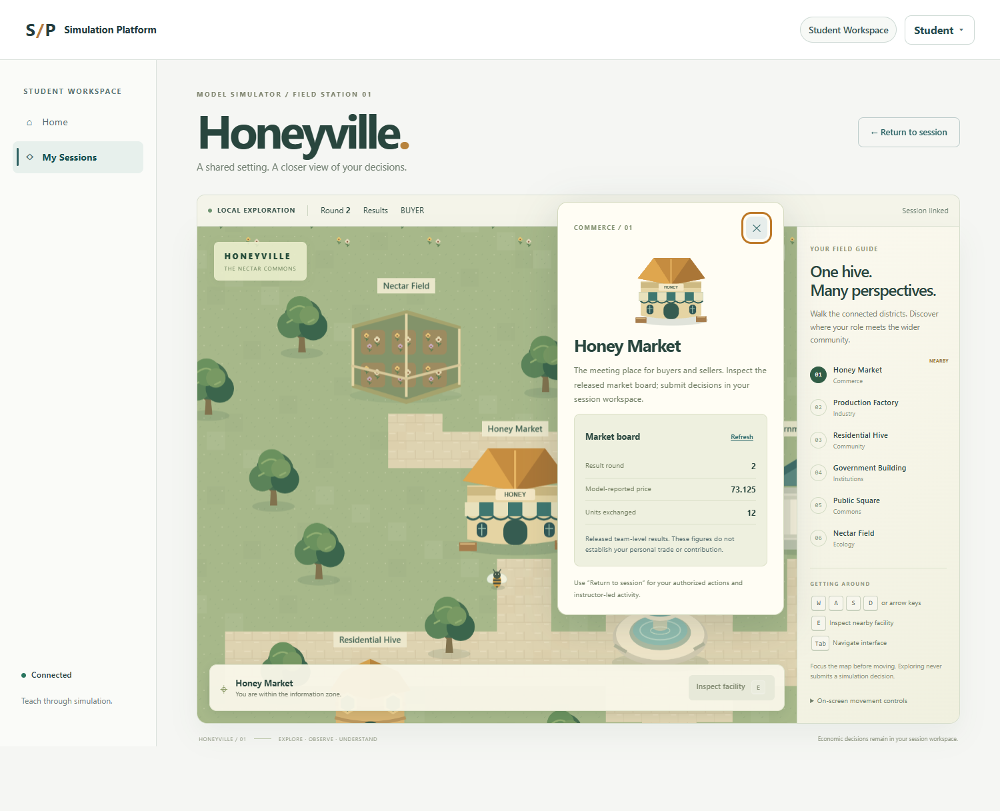

# Honeyville — Batch 2 implementation report

Honeyville is now a functional, session-integrated 2D exploration environment inside the existing React application. A student enters from the simulation workspace, moves a bee across a structured map, collides with buildings/trees/hedges, approaches facilities, opens contextual React panels, inspects released market indicators when the scenario supplies them, and returns without leaving the session.

This batch implements local exploration and information display only. It adds no multiplayer positions, economic actions, wallets, inventories, performance scores, rankings, migrations or backend runtime changes.

## 1. Exact file inventory

Paths below are relative to `ModelSimulator-frontend/Model-Simulator-frontend`.

**Created application files**

| File | Responsibility |
|---|---|
| `src/features/world/HoneyvillePage.tsx` | Authorized session recovery, bootstrap query, existing SignalR invalidation/revocation, React HUD, facility panels, market board and on-screen controls |
| `src/features/world/PhaserWorld.tsx` | Cancellable lazy engine import, one game per mounted world, loading/error/retry UI and deterministic disposal |
| `src/features/world/game.ts` | Phaser preload/create/update, tile layers, data-driven placement, Arcade collision, bee animation/input/camera, local proximity and shutdown cleanup |
| `src/features/world/map.ts` | Bounded Tiled-subset parser, geometry validation, spawn/collision helpers and interaction-zone selection |
| `src/features/world/contracts.ts` | Actual Batch 1 DTO shapes, protocol/session/team/template validation and authenticated read-only bootstrap request |
| `src/features/world/bridge.ts` | Typed per-instance event bridge; retained input-block state for initial pause/load races |
| `src/features/world/prefabs.ts` | Reusable facility visual recipes and decorative fountain behavior, independent of placement and model values |
| `src/features/world/honeyville.json` | Generated, editable Tiled-compatible level data |
| `src/features/world/world.css` | Scoped responsive styling, controls, HUD, guide, loading states and panels |
| `scripts/generate-honeyville.mjs` | Deterministic original SVG and map production source; rerunnable with `npm run world:generate` |

**Created visual assets and evidence**

- `public/world/honeyville/terrain.svg`
- `public/world/honeyville/bee.svg`
- `public/world/honeyville/market.svg`
- `public/world/honeyville/factory.svg`
- `public/world/honeyville/hive.svg`
- `public/world/honeyville/government.svg`
- `public/world/honeyville/square.svg`
- `public/world/honeyville/field.svg`
- `public/world/honeyville/tree.svg`
- `public/world/honeyville/LICENSE.txt`
- `public/world/honeyville/ASSETS.md`
- `public/world/honeyville/THIRD_PARTY_NOTICES.txt`
- `docs/bee-world-batch-2.md`
- `docs/bee-world-batch-2/desktop.png`
- `docs/bee-world-batch-2/mobile.png`

**Created tests/configuration**

- `tests/world-map.test.ts`
- `tests/world-lifecycle.test.tsx`
- `e2e/honeyville.spec.ts`
- `playwright.config.ts`

**Modified existing frontend files**

- `src/app/router.tsx`: lazy Student-protected world route, within existing routing and shell.
- `src/features/simulation/workspace.tsx`: additive “Enter Honeyville” link for launched student sessions; pre-existing user edits preserved.
- `package.json`: exact Phaser/Playwright versions and browser-test/asset-generation scripts.
- `package-lock.json`: corresponding dependency lock updates.
- `vite.config.ts`: exclude Playwright E2E files from Vitest collection; existing proxy and test setup retained.
- `.gitignore`: ignore browser test output/reports.

Backend documentation files: created `ModelSimulator-backend/docs/bee-world-batch-2.md`; updated the implementation-status paragraph in `ModelSimulator-backend/docs/bee-world-architecture-proposal.md`. No C# source, endpoint behavior, equations, admission workflow or migration is changed by Batch 2. Temporary staging/build/test artifacts are not runtime source changes.

## 2. Dependencies, compatibility and licensing

| Item | Verified version | Use / license |
|---|---|---|
| Phaser | **4.2.1**, exact new dependency | Browser renderer/physics/animation/input/camera; MIT |
| `@playwright/test` | **1.65.0**, exact new development dependency | Real headless Edge acceptance tests and screenshots; Apache-2.0 |
| React / ReactDOM | 19.2.8 installed | Existing application; no framework replacement |
| Vite | 6.4.3 installed | Existing bundler/proxy |
| TypeScript | 5.9.3 installed | Existing strict compilation |
| Vitest | 3.2.7 installed | Existing unit/React test runner |
| Node | 22.13.1 in this environment | Development/test execution |

Declared ranges differ from installed versions; compatibility was verified against the installed lockfile rather than copied from template version claims. TypeScript compilation and production bundling pass with Phaser 4.2.1. The engine is dynamically imported only after session/bootstrap recovery; it is not initialized on login, classroom, authoring or ordinary session routes.

Sources reviewed: [official React TypeScript bridge](https://github.com/phaserjs/template-react-ts/blob/main/src/PhaserGame.tsx), [template event bus](https://github.com/phaserjs/template-react-ts/blob/main/src/game/EventBus.ts), [template package manifest](https://github.com/phaserjs/template-react-ts/blob/main/package.json), [Phaser package manifest](https://github.com/phaserjs/phaser/blob/master/package.json), [Phaser license](https://github.com/phaserjs/phaser/blob/master/LICENSE.md), and [Tiled JSON specification](https://github.com/mapeditor/tiled/blob/master/docs/reference/json-map-format.rst). The template's lifecycle ideas were adapted; its application, Vite setup, telemetry scripts and assets were not copied wholesale.

All Honeyville artwork is original SVG coordinate artwork generated by the checked-in production script, not a screenshot or external game asset. It uses one palette, consistent front-facing top-down building perspective, soft ground shadows and restrained amber/forest colors. The new artwork/map/generator carry the adjacent MIT license; this does not relicense existing application code. Phaser and bundled eventemitter3 notices are preserved in `THIRD_PARTY_NOTICES.txt`. No external fonts, paid packs, copied game artwork or image-generation service is required.

## 3. A real level, independent of authoritative results

The level is a finite orthogonal **64×48 tile grid**, with **32×32 world-unit tiles**, totaling **2048×1536 world units**. Its JSON includes Tiled metadata, embedded tileset metadata with a resolvable editor image path, stable object IDs, custom properties, layers, collision footprints, arrival point and interactions.

| Layer | Contents |
|---|---|
| Terrain | Deterministic grass variations |
| Roads | Connected stone paths and civic plaza |
| Details | Flower accents and visible perimeter hedges |
| Collisions | Hidden solid tile layer aligned with perimeter hedges |
| Facilities | Six placed objects referencing allowlisted prefab recipes and purposes |
| Interactions | Information-zone rectangles referencing stable facility/interaction IDs |
| CollisionObjects | Building footprints and tree trunks |
| SpawnPoints | One validated arrival at `(1008, 980)` in the commons |
| Decorations | Reusable tree instances with depth/placement metadata |

Phaser constructs actual tilemap layers from this JSON. It does not draw a single background illustration or hardcode six placements in scene code. Buildings and trees sort by their ground anchor for foreground/background depth; labels remain readable. A subtle fountain ripple is decorative, not a production or resource event. Reduced-motion preference stops decorative/wing animation while preserving movement.

| Stable entity ID | Facility | Purpose in this batch |
|---|---|---|
| `market.hall` | Honey Market | Information panel plus released aggregate board indicators |
| `production.factory` | Production Factory | Scenario-dependent production context; no production action/output |
| `residential.hive` | Residential Hive | Community setting; no housing allocation, account or inventory |
| `government.hall` | Government Building | Institutional context; no implicit policy capability |
| `public.square` | Public Square | Arrival/orientation and contextual guide |
| `nectar.field` | Nectar Field | Environmental context; no invented resource balance |

Map version and static art are separate from the backend projection binding. The metadata declares compatibility with the exact Batch 1 `honeyville.market-foundation` board template/hash/projector. That hash identifies the backend board definition, not a claimed server-authoritative navigation map. Unknown ready bindings fail closed rather than being painted onto an incompatible map.

## 4. Movement and React/Phaser ownership

Controls: focus/click the map, use **WASD or arrow keys**, press **E** or the accessible inspect button near a facility, and use **Tab** for interface navigation. **Escape** closes a focused facility panel. Optional on-screen directional buttons support pointer input. “Return to session” navigates back without calling leave, pause, advance or submit endpoints.

The bee has four directional facings, eight flight frames per direction and idle wing frames. Input vectors are normalized, with a 170-world-unit/second Arcade velocity. Phaser handles stepping/collision/world bounds, camera follow and animation. Immediate key release plus bounded Phaser frame smoothing prevents long headless/stalled frames from carrying an old input across the map. Extremely slow rendering can still reduce effective travel rate; no laptop frame-rate capacity is claimed from software-rendered QA.

Keyboard handlers belong to the focused canvas, not global form input. Movement resets on blur, hidden document, panel opening and pause. Initial paused state is retained while the engine module loads. The world container resizes with the application; desktop and 390px layouts were browser-tested.

React owns authentication, API queries, session status, navigation, loading/errors, panels, accessibility and authoritative number formatting. Phaser owns spatial presentation and emits only local nearby/interact events through a per-world typed bridge. Neither the renderer nor map contains economic equations or action-submission logic.

Lifecycle safety includes a cancellable async loader, one mounted game owner, named listener cleanup, scene shutdown, game destruction, canvas removal, hub disposal and request cancellation. StrictMode, late import completion, asset failure/retry and SPA navigation across two sessions are tested. This establishes specific teardown behavior, not a claim that every possible heap leak has been disproved by profiling.

## 5. Backend and session integration

The route is `/student/sessions/:sessionId/world`, under the existing Student protection and shell. Entry appears only after the existing session recovery confirms participant/team/role and launch status. Page refresh repeats the same authorized recovery. There is no replacement login, classroom admission, session join, instructor control or role assignment process.

The route uses the existing `ApiClient` (token refresh, error handling, cancellation) and Batch 1 `GET /api/v1/sessions/{id}/world/bootstrap`. It reads the actual `{ protocolVersion, status, snapshot }` schema and validates protocol, session/team identity and exact supported binding before using snapshot data. Decimal indicators stay strings. Queries are scoped by user/session/team and refreshed on existing SignalR invalidations, reconnect, focus and a 15-second recovery interval. Existing `SessionAccessRevoked` immediately removes the canvas and contextual state. There are no movement messages or position writes.

For `ready`, the Honey Market panel shows only the board's allowlisted round/price/quantity/unmatched indicators. Results are explicitly team-level; they do not claim personal trades or decision quality. Static facilities remain independent from that projection. Refresh is an authenticated GET.

For `not-bound`, the student may explore a clearly labeled informational town with no market outcome substituted. `team-required`, unavailable projection, unsupported template, malformed data, HTTP errors and revoked access receive appropriate waiting/unavailable/error states. No fake economic fallback is shipped. A 503 or access failure does not keep displaying a stale private panel as current.

**Binding prerequisite:** Batch 1 did not opt existing scenarios into world projections. A newly published compatible scenario must carry `CompetitiveMarketWorldProjector.DefaultBinding` to provide market-board data. Existing model-specific authoring screens still do not author this binding; manual publication through the existing supported backend contract remains necessary. Unbound sessions are functional exploration without market numbers. No frozen manifest is rewritten by this frontend batch.

## 6. Validation and evidence

Final validation results:

| Check | Result |
|---|---|
| Frontend production build (`npm run build`) | Passed: strict TypeScript and Vite bundling |
| Existing plus new frontend unit/React suite (`npm test`) | **139 passed**, 14 files, zero failed; 14 new tests |
| Actual-browser acceptance (`npm run test:world:browser`) | **12 passed**, headless Edge, approximately 1.6 minutes |
| Backend Release solution build | Passed, zero errors |
| Backend unit suite | **112 passed** |
| Backend architecture suite | **6 passed** |
| PostgreSQL integration suite | **129 passed**, zero failed/skipped, approximately 1m54s; fixture collections serialized as in Batch 1 |
| Source checks | Frontend `git diff --check` passes; pre-existing modified workspace was verified byte-for-byte after removing the additive entry/imports |

Backend commands used `--configuration Release --no-restore` and tests additionally used `--no-build`; PostgreSQL test settings included `xUnit.ParallelizeTestCollections=false`. Existing SSH.NET advisories remain unchanged. Production bundling reports existing SignalR PURE-annotation warnings and an engine chunk-size warning; neither prevents the build. No warning thresholds were increased.

The acceptance scope includes:

- map parsing, editor atlas path, spawn/perimeter/building validity and reachability of all six zones;
- identity/template-safe bootstrap parsing, decimal precision, authorized GET/cancellation and no model mutation;
- per-world bridge isolation and initial pause retention;
- StrictMode, missing assets, rejected/late renderer import and disposal;
- actual headless Edge rendering, keyboard/directional controls, building/perimeter collision, focus behavior, nearby panels, projection display, SPA session changes, missing-asset recovery, unbound/error states, route authorization, pause/revocation and responsive controls.

Browser tests use deterministic **test-only HTTP and SignalR doubles** to exercise the actual React/Phaser application. They are not a live classroom deployment or proof of model mathematics; production code always calls the real existing API. Backend authorization/model behavior is separately checked through the full real PostgreSQL regression suite. Screenshot numbers are fixture inputs, not actual student/classroom outcomes.

[Narrow-screen rendering](bee-world-batch-2/mobile.png). These are screenshots of actual running Phaser scenes, not concept illustrations.

## 7. Remaining limits

- One local bee only; no multiplayer pose synchronization, NPC intelligence, player inventories, economic transactions, scoring or leaderboards.
- Informational proximity is local and never a backend permission check. Server-trusted proximity requires a separate approved batch before spatially restricted economic actions.
- Market data requires a compatible bound scenario and obeys Batch 1 release policy, including its existing Reflection/completed-phase limitations.
- No new instructor world editor, binding-authoring UI, procedural generation, durable world revision/delta recovery or new simulation runtime.
- Functional browser testing used installed headless Edge/software rendering; Safari, Firefox, ordinary-laptop frame budgets and live-classroom end-to-end verification remain separate work.
- Phaser is lazily split into its own roughly 384KB gzip engine chunk. Build warnings for chunk size and existing SignalR annotations remain; no artificial warning threshold was raised.
- Dependency audit identified existing Vite/Vitest/transitive development-tool advisories. No unrelated major tooling upgrade or automatic audit fix was applied.

Batch 2 stops here. The map, art, controls and panels are implemented; subsequent networking, transactions and assessment phases remain unauthorized and unimplemented.
