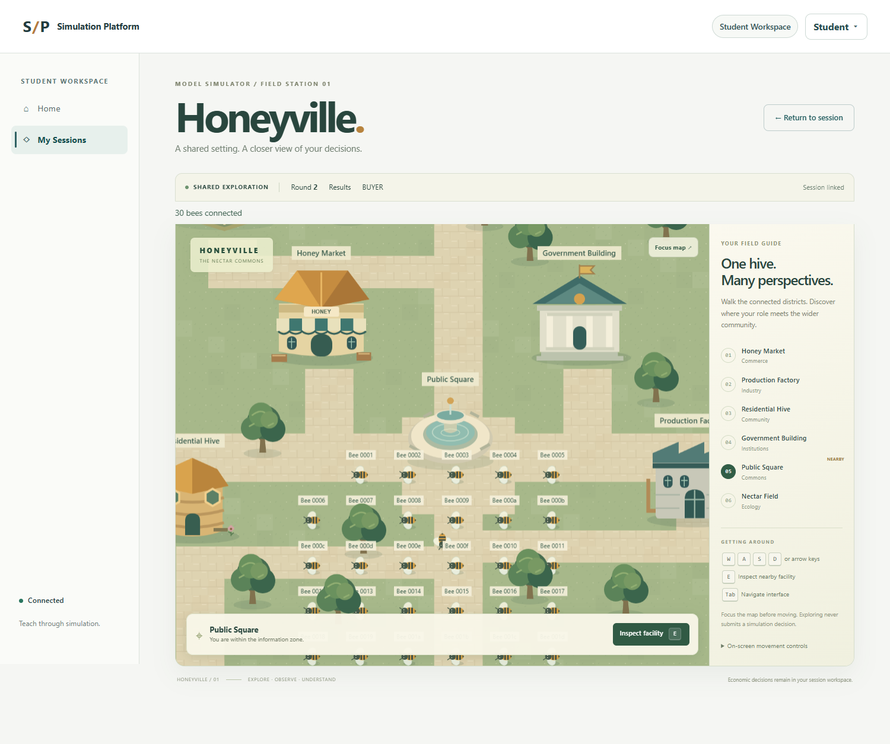

# Honeyville Batch 3B — frontend multiplayer

Implemented against the actual Batch 3A checkout on 2026-11-14. This changes frontend presence/rendering only. Live two-student verification remains pending because no listening backend or live acceptance credentials were available in this environment. Mocked browser acceptance is not evidence of live backend compatibility.

## Exact frontend inventory

Modified:

- `src/features/world/HoneyvillePage.tsx`: authenticated presence owner, session completion handling, count/status/control UI, cleanup on session/team/unmount changes.
- `src/features/world/bridge.ts`: retained presence frames, epoch, local pose and correction events on the existing per-world bridge.
- `src/features/world/game.ts`: remote sprites/labels, interpolation, authoritative initialization, navigation checks, reconciliation, observer control fencing, diagnostics and scene disposal.
- `src/features/world/world.css`: small presence status styling.
- `e2e/honeyville.spec.ts`: world-hub transport fixtures, moving 30-player rendering, observer/reconnect/removal acceptance and multiplayer-aware navigation fixtures.

Added:

- `src/features/world/presence-contracts.ts`: unchanged copy of backend `docs/contracts/world-presence-v1.ts`.
- `src/features/world/presence.ts`: dedicated authenticated SignalR adapter and bounded recovery/movement state.
- `src/features/world/navigation-v1.json`: unchanged reviewed backend geometry resource.
- `src/features/world/navigation.ts`: v1 swept expanded-AABB checks and playable-center bounds.
- `src/features/world/interpolation.ts`: bounded 120ms interpolation.
- `tests/world-presence.test.ts`: contract, ownership, ordering, acknowledgments, recovery, geometry, isolation and cleanup tests.
- `e2e/world-live.spec.ts`: opt-in independent authenticated browser-context acceptance against the real backend.
- `docs/bee-world-batch-3b.md`: this report.
- `docs/bee-world-batch-3b/thirty-bees.png`: actual Phaser screenshot with simulated peers.
- `docs/bee-world-batch-3b/rendering-metrics.json`: moving 30-bee browser measurements.
- `docs/bee-world-batch-3b/baseline-metrics.json`: comparable one-bee browser measurements.

Pre-existing changes outside this inventory were preserved. No backend source, economic transaction, inventory, scoring, leaderboard, classroom admission, authentication protocol or economic model was changed. No dependency was added.

## Consumed contract and transport

Authoritative inputs inspected: backend `docs/bee-world-batch-3a.md`, `docs/bee-world-presence-v1.md`, `docs/contracts/world-presence-v1.ts`, C# `PresenceContracts.cs`, `WorldPresenceHub.cs`, `WorldPresenceStore.cs`, `HoneyvilleGeometry.cs`, and hub registration/options in `Program.cs` (2048-byte receive limit, one parallel invocation per transport).

- JSON protocol version **1**, authenticated **`/hubs/world`**.
- Methods: `EnterWorld(sessionId)`, `RecoverWorld({protocolVersion:1,sessionId})`, `MoveWorld(WorldMove)`, `LeaveWorld(sessionId)`.
- Event: `WorldPresenceChanged(PresenceEvent)`; joined/moved/updated/left.
- Existing `/hubs/sessions`, authorized HTTP world bootstrap and token refresh remain in use. Rendering objects never own connections.
- The consumed TypeScript source's LF-normalized SHA-256 is `f580e3b7a26f3f5cbeb4aafbda4685b31a38b682b0c7775f8cfed2d2f6c10058`.
- The v1 canonical geometry hash is `d9e984756b42489ee9fc7abb97c026d26c2187fd6ce20762b66effe4009dd5b9`. A mismatched server geometry fails closed. Contract/geometry tests run without requiring the adjacent backend repository; when present, its files are additionally compared directly.

The adapter registers its event handler before entry. Server-issued player IDs identify sprites; account IDs and player IDs are never supplied by the client. Protocol v1 omits names/emails, so labels use anonymous player-ID prefixes. Hovering a bee shows its public team-ID prefix. No role labels or private team model data are broadcast.

## Movement, ownership and rendering

Local keyboard/on-screen input remains responsive in the original single Phaser scene and canvas. Input is disabled until an authoritative roster grants a nonempty private lease; observer tabs render their own accepted actor without creating a duplicate remote sprite. Own control-reset events fence movement and recover the private lease before another send. A secondary tab does not continuously attempt movement. “Check movement control” uses documented repeated `EnterWorld`: it can acquire unclaimed control but cannot steal an active controller's lease from an existing observer connection. New transports follow the backend's automatic lease policy.

The sender samples the latest pose at a 100ms scheduler interval and also checks elapsed monotonic time, allowing at most ten movement attempts per second. It serializes hub invocations, coalesces unsent positions, increments sequences under the current lease/epoch, validates returned acknowledgments, and never replays disconnected or rejected poses. An idle stop is sent when needed; unchanged idle coordinates are suppressed. Recover/entry/leave calls share that serialization. Failures back off for two seconds rather than resending rejected coordinates. No movement is written to local storage or economic persistence.

Acknowledgments update accepted own state without changing roster revision. Since accepted proposals are not server-clamped, ordinary acknowledgments preserve current local prediction. Rejections/snapshots correct prediction: offsets decay by 35% each rendered frame while fresh input continues; discrepancies over 80 world units reset position. Initial/re-entered actors initialize from the accepted server position, including retained positions in another tab. Local collision radius is ten world units; the reviewed swept geometry additionally rejects corner crossing and matches bounds `[42,2006] × [42,1494]`. The server remains authoritative.

Remote sprites are keyed by player ID, reuse the original bee sheet, interpolate from the rendered position to the latest accepted sample over 120ms, use directional fly/idle animations, honor reduced motion, and sort by y depth. Interpolation never extrapolates indefinitely. Missing further movement becomes visual idle after 250ms. Removed actors immediately destroy their sprite and label. Epoch changes reset interpolation and actor initialization. Sprites are reused between updates; no sprites/text are created every frame. React receives count/status/ownership changes, rather than each peer pose update.

## Recovery and lifecycle

Snapshots replace the entire roster. Unsafe integer revisions/sequences, unsupported versions, malformed poses and incompatible geometry are rejected. Other sessions' events are ignored. Duplicate/older revisions are dropped. Gaps and unknown epochs fence input, buffer at most 128 events and coalesce recovery. Events received during a snapshot are sorted, discarded through its fence and applied only as a contiguous later sequence. Missing events recover from complete snapshots, never guessed deltas.

`RecoverWorld` is scheduled every ten seconds when no invocation is in flight, including while idle/observing/paused, to refresh membership and detect a final missed event. `world.entry_required` causes fresh entry. Reconnect discards pending movement/old leases and enters again. Disconnect immediately clears remote presence. Failed recovery cannot retain visible stale peers beyond thirty seconds without a successful own move or snapshot, even if a recovery invocation stalls; terminal authorization/geometry failures clear and stop the world connection. A manual reconnect is available after transport exhaustion or initial connection failure.

Pause blocks input/sending while retaining visible members and heartbeat recovery; resume refreshes state and permits movement with the valid lease. Completed/terminated/deleted session states unmount the world. Existing session access revocation immediately unmounts it. Navigation, logout, team/session switching and unmount remove handlers/timers, leave when no invocation is pending, stop the transport, destroy sprites and dispose the existing game owner. When an invocation is pending, transport stop releases membership through backend disconnect cleanup. Late asynchronous results cannot publish after disposal.

## Validation and performance

Final validation:

| Check | Result |
|---|---|
| `npm run build` | Passed: strict TypeScript and Vite production build |
| `npm test` | **161 passed**, 17 files, including 22 new presence tests |
| `npm run test:world:browser` | **16 passed, 1 skipped**, zero failures, approximately 1m42s |
| Real-backend two-student browser test | Explicitly skipped: live accounts/session/backend not configured |
| Scoped `git diff --check -- src/features/world e2e/honeyville.spec.ts` | Passed |

The existing SignalR PURE-annotation and large Phaser chunk warnings remain. The global working-tree whitespace check also identifies a pre-existing blank line in `src/features/student/admission.tsx`, which this batch did not edit.

Coverage includes connection/entry, full roster creation/removal, controller/observer tabs, private lease refresh, movement sequences/acknowledgments, serialized/coalesced invocations, duplicates and stale events, gaps, in-flight snapshot fencing, epoch replacement, re-entry after expiry, rejection recovery, stalled-recovery expiry, geometry compatibility, cross-session events, React update suppression, disposal/late results, actual Phaser navigation/destruction, pause, revocation, keyboard/touch input, sprite removal and actual SignalR-client reconnection through a mocked WebSocket transport.

Browser conditions: Windows, Intel Core i5-11400H @ 2.70GHz (12 logical processors), approximately 16GiB RAM, headless Microsoft Edge 157, 1500×1120 viewport, existing Playwright `--use-angle=swiftshader`, Vite development build, one worker. Five-second requestAnimationFrame samples include the full Honeyville scene, React shell, text and 29 remote actors. Scripted peer poses arrive at a nominal ten batches/second, each containing 29 individual protocol events. Heap values are Chromium's approximate used JS heap, not process RSS or retained-heap profiling.

| Browser sample | Average FPS | p95 frame interval | Approximate used JS heap |
|---|---:|---:|---:|
| One bee, idle baseline | 26.12 | 48.5ms | 31.6MB |
| Thirty bees, 29 scripted moving peers | 23.69 | 48.7ms | 43.4MB |

The moving-peer sample delivered **1,276 actor events in approximately 5.02s**, about **254 events/s**, across 44 scripted batches. These are intercepted test WebSocket deliveries, not measurements of backend network throughput. Local sender tests verify at most ten attempts/second and no parallel movement invocation; idle/observer movement is suppressed. The browser reconnect test confirms a second world WebSocket connection, a recovered three-actor roster, and one canvas. Removing a peer reduces rendered remote count from 29 to 28; leaving removes the canvas. These checks do not establish a long-duration heap plateau.

These measurements establish simulated browser rendering behavior only. They do not establish real SignalR/database/network capacity, ordinary GPU laptop frame rates, long-duration memory stability, or LAN latency. Pooling was not added: actor count is bounded, existing sprites are reused, removal destroys them, and these tests do not identify sprite allocation as the frame bottleneck. Software-rendered frame rate is a remaining performance limit requiring ordinary GPU profiling before rollout.

## Live acceptance prerequisites and remaining limits

Run the opt-in `e2e/world-live.spec.ts` using two existing authorized student accounts in the same **Running**, Honeyville-bound session. Set `WORLD_STUDENT_EMAIL`, `WORLD_STUDENT_PASSWORD`, `WORLD_PEER_EMAIL`, `WORLD_PEER_PASSWORD`, `WORLD_SESSION_ID`, and optionally `API_ORIGIN` (default `http://127.0.0.1:5070`). Set Vite's `API_PROXY_TARGET` to that backend and restart an already-running Vite server so it reads the target. Do not commit credentials. The test logs in independently, loads both actual worlds, verifies the first actor's motion in the other browser, cycles one context offline/online, and checks recovery. It creates no accounts, classroom sessions or economic submissions. Without prerequisites it explicitly skips.

No backend contract defect was confirmed by source inspection. Anonymous identities, polling-based passive revocation, unbound-world rejection, server-owned exclusive leases and single-API-instance deployment are documented protocol constraints. Existing local-only exploration remains available to unbound scenarios. The current page retains Batch 2's participant/team/role entry requirements; this batch does not change classroom readiness policy.

Live two-student compatibility, real classroom load and production GPU performance remain unverified. Browser fixtures exercise the real React/Phaser/SignalR client through a deterministic test transport, not the actual server. The live definition of done therefore remains an acceptance step, not a result claimed by this report.
